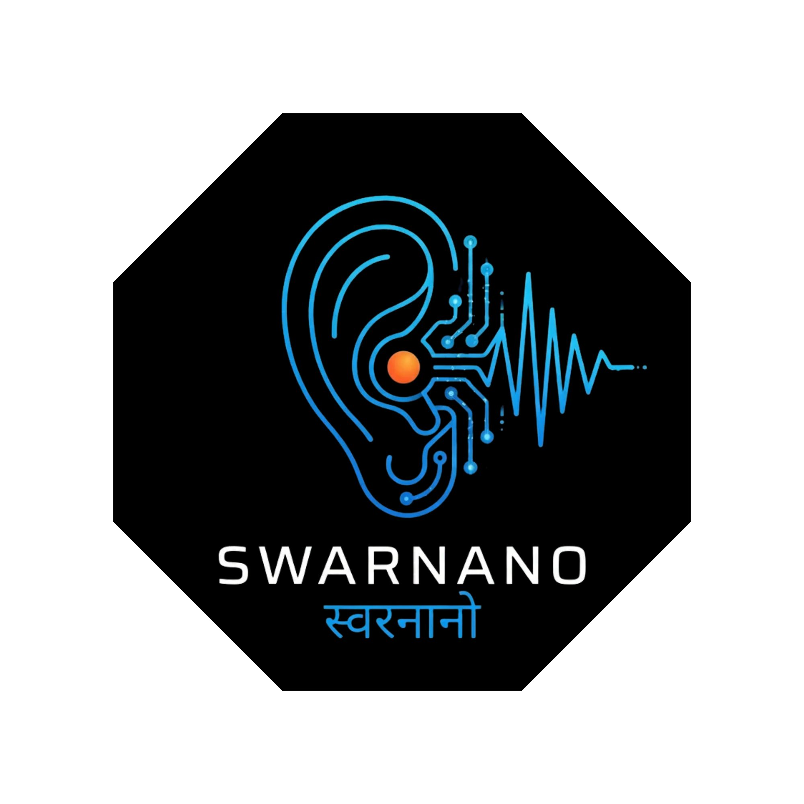

# SwarNano v1

## Project links

- Hugging Face: https://huggingface.co/dhoni420/SwarNano-v1
- GitHub: https://github.com/Dhoniprotocol/SwarNano-v1

## GitHub source and v1 browser server

The GitHub repository includes the v1 inference runtime
([`serve_tts_v1.py`](./serve_tts_v1.py) and
[`language_frontend.py`](./language_frontend.py)), a command-line runner, and
a local browser server. See [`SERVER_V1.md`](./SERVER_V1.md) for Windows setup
and usage. The Hugging Face repository remains weights-only.

<p align="center">
  
</p>

SwarNano v1 is a Nepali text-to-speech model. This repository publishes the
FP32 and INT8 model weights, inference source, minimal vocabulary/speaker
metadata, and attribution notices. It does not include the training pipeline
or source dataset audio and transcripts.

## Audio samples

### Sample 1

एकादेशमा हरियाली डाँडाले घेरिएको एउटा सुन्दर गाउँ थियो। त्यो गाउँको छेउमा एउटा घना जङ्गल थियो।

[Open or download Sample 1 WAV](./samples/demo_01.wav)

### Sample 2

सबै जनावरहरूले राजाको कुरा ध्यान दिएर सुने। तर, चङ्खे भने एउटा पुतलीलाई लखेट्नमै व्यस्त थियो।

[Open or download Sample 2 WAV](./samples/demo_02.wav)

The WAV files are example speech outputs; the text above is the transcript for
each sample.

## Model details

- **Task:** Nepali text-to-speech.
- **Language:** Nepali.
- **Voices:** 18 female voice options are available. They are model voice
  embeddings, not verified identities.
- **Audio output:** The included examples are mono WAV at 22,050 Hz.
- **Weights:** [`weights/swarnano_v1_fp32.pt`](./weights/swarnano_v1_fp32.pt)
  and [`weights/swarnano_v1_int8.xz`](./weights/swarnano_v1_int8.xz).
- **Metadata:** [`weights/swarnano_v1_meta.json`](./weights/swarnano_v1_meta.json)
  contains the phone vocabulary and voice-ID map.

## Capabilities at a glance

The included runtime turns Nepali text into spoken audio and supports 18
female voice options. Two weight formats are provided:

- **FP32:** about 6.2 MiB.
- **INT8 compressed:** about 1.4 MiB for a smaller download and storage
  footprint.

These are file sizes, not speed or quality benchmarks. No comparative
performance claims are made for the two formats.

The included runtime supports the released v1 weights only. It does not
include training code or the v2/multilingual model runtime.

## Running locally

The v1 inference source is included. On Windows, create the CPU environment
and install the pinned dependencies:

```powershell
python -m venv .venv
.\.venv\Scripts\Activate.ps1
python -m pip install --upgrade pip
python -m pip install -r .\requirements-v1.txt
```

Generate a WAV from the command line:

```powershell
python .\run_swarnano.py --text "नमस्ते, यो स्वरनानो हो।" --model .\weights\swarnano_v1_fp32.pt --speaker 0 --output .\output.wav
```

To use the compressed INT8 weights, set `--model` to
`.\weights\swarnano_v1_int8.xz`. Select a female voice using its index (`0` to
`17`) or the source voice ID from `weights/swarnano_v1_meta.json` (for
example, `0258`). Use `python .\run_swarnano.py --help` to see all options.
To start the browser UI, run `python .\server_tts_v1.py` and open
`http://127.0.0.1:8000`. Synthesis runs locally; no text or audio is sent to
a cloud API. See [`SERVER_V1.md`](./SERVER_V1.md) for details.

## License

The weights, metadata, and included v1 source files
(`serve_tts_v1.py`, `language_frontend.py`, `run_swarnano.py`, and
`server_tts_v1.py`) are offered under
[CC BY-SA 4.0](https://creativecommons.org/licenses/by-sa/4.0/), to the extent
the release publisher holds the necessary rights. Commercial use is allowed
under the license terms, including attribution and ShareAlike for adaptations.
This grant does not include source dataset audio or transcripts.

## Intended use and limitations

Use for Nepali speech synthesis, research, and evaluation, subject to the
license and applicable third-party rights. Do not present generated speech as
a real recording or use it to impersonate a person.

Speech quality, pronunciation, and prosody may vary. The model is Nepali-only
and its 18 female voice embeddings come from the female-speaker source corpus.
They should not be treated as verified identities. The dataset license alone
may not grant publicity, privacy, or other personality rights.

## Data and attribution

The model weights were created using OpenSLR SLR43, which OpenSLR lists under
CC BY-SA 4.0 and credits to Google LLC. No source dataset audio or transcripts
are included. Keep [`DATASET_ATTRIBUTION.md`](./DATASET_ATTRIBUTION.md) with
redistributed copies and adaptations.

See [`LICENSE`](./LICENSE) and [`LICENSING.md`](./LICENSING.md) for scope and
third-party attribution details.

## Repository files

- `weights/` — FP32 and INT8 model weights plus minimal metadata.
- `serve_tts_v1.py`, `language_frontend.py` — v1 inference implementation.
- `run_swarnano.py`, `server_tts_v1.py` — command-line and local browser runners.
- `requirements-v1.txt`, `SERVER_V1.md` — CPU dependencies and setup guide.
- `samples/` — two example speech WAVs with their transcripts above.
- `assets/` — SwarNano logo used on this card.
- `DATASET_ATTRIBUTION.md`, `LICENSE`, `LICENSING.md` — license and attribution
  notices.
- `SHA256SUMS.txt` — checksums for both weight files.

**Created by:** Sandesh Bastola  
**Project:** SwarNano  
**Version:** v1.0
